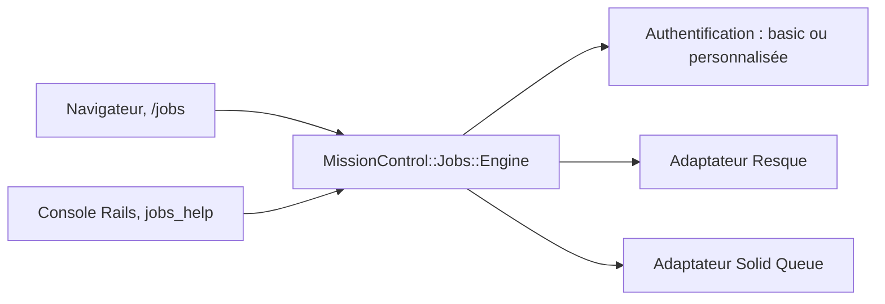

# rails/mission_control-jobs

> Interface web Rails pour inspecter, relancer et supprimer les jobs Active Job (Resque, Solid Queue).

## Le problème
Sans outil dédié, comprendre pourquoi des jobs d'arrière-plan échouent ou s'accumulent oblige à fouiller Redis ou la base à la main.

## Ce que ça fait vraiment
Un moteur Rails à monter dans `routes.rb` qui liste les files et les jobs par statut, filtrés par file ou classe. Il permet de relancer ou supprimer les jobs en échec, de mettre en pause une file et de voir les workers. Une API console permet des opérations en masse. Il gère plusieurs applications et plusieurs adaptateurs.

## Comment c'est branché


## Essayer
```bash
bundle install
bin/rails mission_control:jobs:authentication:configure
```
Ajouter `gem "mission_control-jobs"` au Gemfile, puis `mount MissionControl::Jobs::Engine, at: "/jobs"`.

## Coût et pièges
Gratuit. L'authentification HTTP basic est fermée par défaut : sans identifiants, l'interface est inaccessible. Solid Queue demande la version 1.0.1 ou plus.

## Ce que ce n'est pas
Pas un outil général de supervision ni de planification. Les fonctions dépendent de l'adaptateur, et les opérations destructrices en masse se font surtout en console.

## Alternatives
Aucune alternative nommée dans le README.

## Pour toi
À ignorer sauf si tu exploites une application Rails ; il ne concerne ni Airflow ni les pipelines data ou IA.

