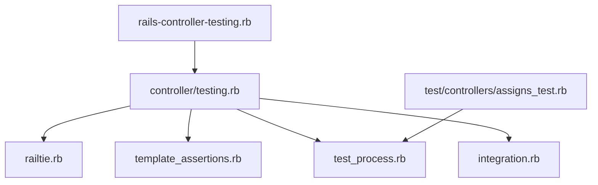

# rails/rails-controller-testing

> Rails gem that restores `assigns` and `assert_template` in controller tests, removed in Rails 5.

## The problem
Test suites written before Rails 5 use assertions that were removed from the framework.

## What it actually does
The gem includes the `TestProcess`, `TemplateAssertions` and `Integration` modules into tests via a railtie. `assigns` exposes the instance variables passed to views, `assert_template` checks the rendered templates. rspec-rails integrates it on its own since version 3.5.0.

## How it is wired
Diagram based on the code diagram.


## Trying it
```bash
gem install rails-controller-testing
```
Outside Rails: `Rails::Controller::Testing.install` in `test/test_helper.rb`.

## Cost and gotchas
Free. Last push in June 2023: little maintenance.

## What it is not
It is not a modern testing best practice: these assertions were deliberately removed from Rails.

## Alternatives
No alternative named in the README.

## For you
Ignore: only useful for maintaining an old Rails test base, far from your field.
