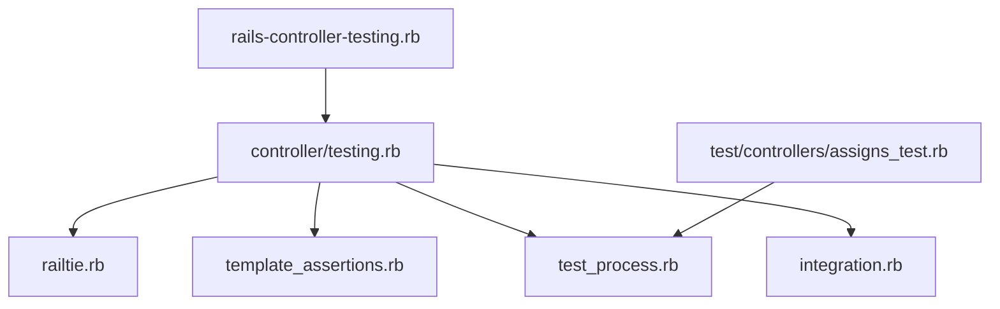

# rails/rails-controller-testing

> Gem Rails qui rétablit `assigns` et `assert_template` dans les tests de contrôleurs, supprimés en Rails 5.

## Le problème
Des suites de tests écrites avant Rails 5 utilisent des assertions retirées du framework.

## Ce que ça fait vraiment
Le gem inclut les modules `TestProcess`, `TemplateAssertions` et `Integration` dans les tests via un railtie. `assigns` expose les variables d'instance passées aux vues, `assert_template` vérifie les gabarits rendus. rspec-rails l'intègre seul depuis la version 3.5.0.

## Comment c'est branché
Schéma d'après le diagramme du code.


## Essayer
```bash
gem install rails-controller-testing
```
Hors Rails : `Rails::Controller::Testing.install` dans `test/test_helper.rb`.

## Coût et pièges
Gratuit. Dernier push en juin 2023 : peu de suivi.

## Ce que ce n'est pas
Ce n'est pas une bonne pratique de test moderne : ces assertions ont été retirées à dessein de Rails.

## Alternatives
Aucune alternative nommée dans le README.

## Pour toi
À ignorer : utile seulement pour maintenir une vieille base de tests Rails, loin de ton domaine.

