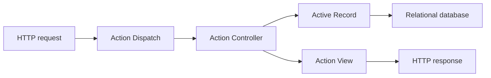

# rails/rails

> Ruby web framework based on the MVC (Model-View-Controller) architecture, with everything needed to build applications that connect to a database.

## The problem
Building a web application with a database requires reassembling routing, models, views, tasks, and emails.

## What it actually does
The Action Dispatch route sends the request to a controller (Action Controller), which handles Active Record models and renders an Action View. Around this, the following components are used: Active Job, Action Mailer, Action Mailbox, Action Cable (WebSockets), Active Storage, Action Text, and Active Support. Several components are used independently.

## How it is wired


## Trying it
```bash
gem install rails
rails new myapp
cd myapp
bin/rails server
```

## Cost and gotchas
Free. Requires Ruby (version not specified in the README). The local server listens on port 3000.

## What it is not
Not a data tool: a Ruby framework for web applications.

## Alternatives
No alternative is specified in the README file.

## For you
Ruby should be avoided for a data/AI project in Python, except for maintaining an existing Rails service.
