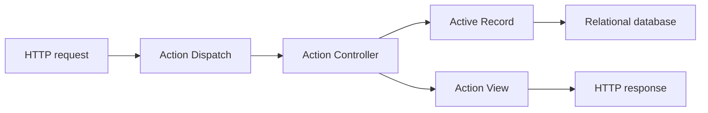

# rails/rails

> Framework web Ruby en MVC, avec tout le nécessaire pour des applications adossées à une base.

## Le problème
Construire une application web avec base de données exige de réassembler routage, modèles, vues, tâches et courriels.

## Ce que ça fait vraiment
Action Dispatch route la requête vers un contrôleur (Action Controller) qui manipule des modèles Active Record et rend une vue Action View. Autour : Active Job, Action Mailer, Action Mailbox, Action Cable (WebSockets), Active Storage, Action Text, Active Support. Plusieurs composants s'utilisent seuls.

## Comment c'est branché


## Essayer
```bash
gem install rails
rails new myapp
cd myapp
bin/rails server
```

## Coût et pièges
Gratuit. Nécessite Ruby (non précisé dans le README). Le serveur local écoute sur le port 3000.

## Ce que ce n'est pas
Pas un outil data : un framework Ruby pour applications web.

## Alternatives
Aucune alternative nommée dans le README.

## Pour toi
À ignorer pour un profil data / IA en Python : Ruby, sauf maintenance d'un service Rails existant.

