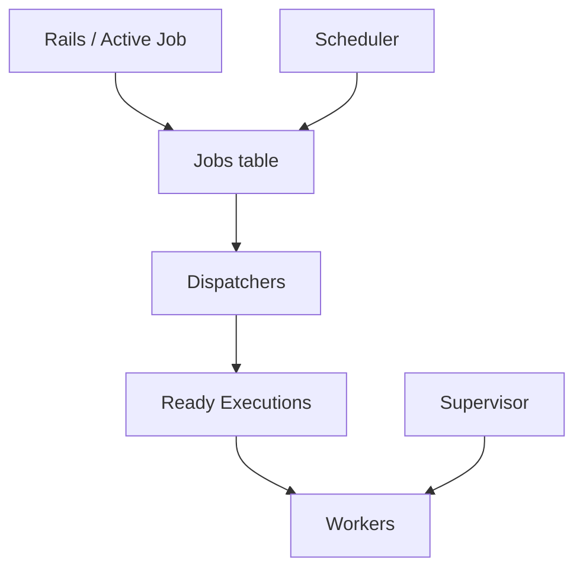

# rails/solid_queue

> Active Job queue backend backed by a SQL database, for Rails applications.

## The problem
Running background jobs often requires Redis or another service in addition to the database.

## What it actually does
Stores jobs in the database (MySQL, PostgreSQL, SQLite) and uses `FOR UPDATE SKIP LOCKED` when available. Workers (threads or fibers), dispatchers for delayed jobs, a scheduler for recurring tasks, a supervisor with heartbeats. Priorities, concurrency control through semaphores, queue pausing, batches with callbacks, a Puma plugin. Rails ≥ 7.1 and Ruby ≥ 3.2; included by default in Rails 8.

## How it is wired


## Trying it
```bash
bundle add solid_queue
bin/rails solid_queue:install
bin/jobs
bin/jobs check
```

## Cost and gotchas
Free. The queue database is recommended to be separate from the application database; concurrency controls add a notable overhead; no automatic retry after a process is killed abruptly (jobs are marked as failed).

## What it is not
Not a data pipeline orchestrator: it is a Rails job queue.

## Alternatives
- resque and GoodJob: cited as inspirations for the project.

## For you
Worth watching: useful only if you expose models through a Rails app; otherwise, a dedicated orchestrator is a better fit.
