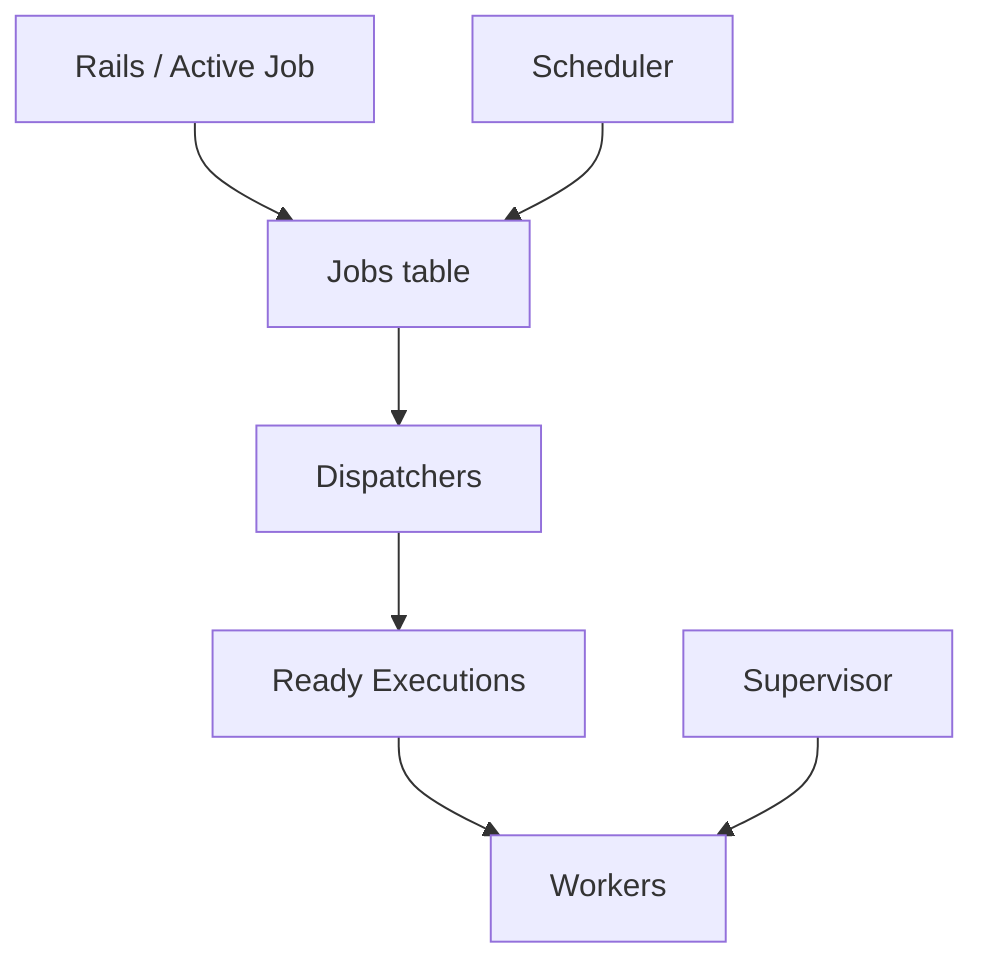

# rails/solid_queue

> Backend de file de jobs Active Job adossé à une base SQL, pour applications Rails.

## Le problème
Exécuter des jobs en arrière-plan impose souvent Redis ou un autre service en plus de la base.

## Ce que ça fait vraiment
Stocke les jobs en base (MySQL, PostgreSQL, SQLite) et utilise `FOR UPDATE SKIP LOCKED` quand disponible. Workers (threads ou fibres), dispatchers pour jobs différés, scheduler de tâches récurrentes, superviseur avec heartbeats. Priorités, contrôle de concurrence par sémaphores, pause de files, lots (batches) avec callbacks, plugin Puma. Rails ≥ 7.1 et Ruby ≥ 3.2 ; inclus par défaut dans Rails 8.

## Comment c'est branché


## Essayer
```bash
bundle add solid_queue
bin/rails solid_queue:install
bin/jobs
bin/jobs check
```

## Coût et pièges
Gratuit. Base de file recommandée séparée de la base applicative ; les contrôles de concurrence ajoutent un surcoût notable ; pas de retry automatique après mort brutale d'un process (jobs marqués échoués).

## Ce que ce n'est pas
Pas un orchestrateur de pipelines de données : c'est une file de jobs Rails.

## Alternatives
- resque et GoodJob : cités comme inspirations du projet.

## Pour toi
À surveiller : utile seulement si tu exposes des modèles via une app Rails ; sinon, un orchestrateur dédié convient mieux.

