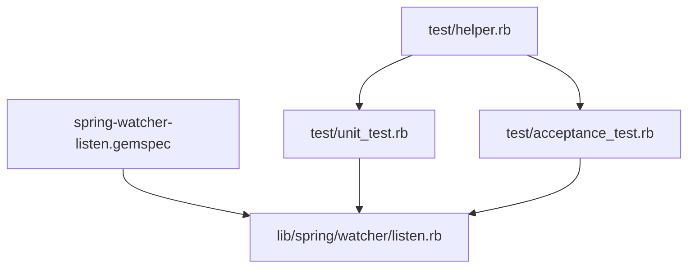

# rails/spring-watcher-listen

> Ruby gem that makes Spring watch files through Listen instead of polling.

## The problem
On large Rails projects, Spring's file system polling is slow and uses a lot of CPU.

## What it actually does
The gem replaces Spring's polling with the Listen library, which is more responsive. All the code fits in `lib/spring/watcher/listen.rb`, covered by unit and acceptance tests. Network drives (NFS), shared virtual machine folders and user-space file systems still require polling.

## How it is wired


## Trying it
```bash
spring stop
bundle
```
```ruby
gem 'spring-watcher-listen', group: :development
```

## Cost and gotchas
Ruby and Bundler are required. The `DISABLE_SPRING_WATCHER_LISTEN` variable disables it (Docker on Mac M1). Last push in September 2022.

## What it is not
Not a useful tool outside Rails projects that use Spring.

## Alternatives
No alternative named in the README.

## For you
Ignore: Rails development comfort, unrelated to data or AI.
