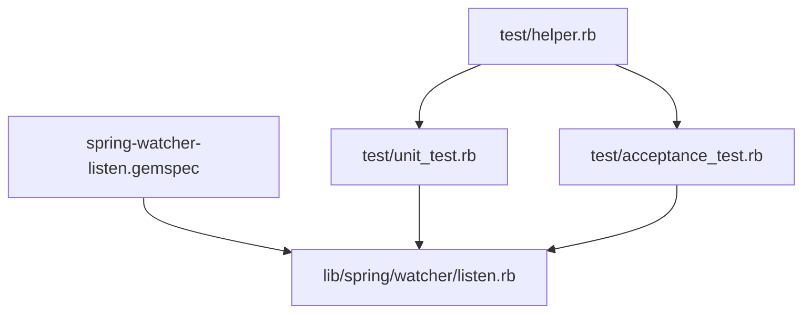

# rails/spring-watcher-listen

> Gem Ruby qui fait surveiller les fichiers à Spring via Listen plutôt que par sondage.

## Le problème
Sur de gros projets Rails, le sondage du système de fichiers par Spring est lent et consomme du processeur.

## Ce que ça fait vraiment
Le gem remplace le sondage de Spring par la bibliothèque Listen, plus réactive. Tout le code tient dans `lib/spring/watcher/listen.rb`, testé en unitaire et en acceptation. Les disques réseau (NFS), dossiers de machines virtuelles partagés et systèmes de fichiers utilisateur exigent toujours le sondage.

## Comment c'est branché


## Essayer
```bash
spring stop
bundle
```
```ruby
gem 'spring-watcher-listen', group: :development
```

## Coût et pièges
Ruby et Bundler sont nécessaires. Variable `DISABLE_SPRING_WATCHER_LISTEN` pour le désactiver (Docker sur Mac M1). Dernier push en septembre 2022.

## Ce que ce n'est pas
Pas un outil utile hors des projets Rails qui utilisent Spring.

## Alternatives
Aucune alternative nommée dans le README.

## Pour toi
À ignorer : confort de développement Rails, sans rapport avec la data ou l'IA.

