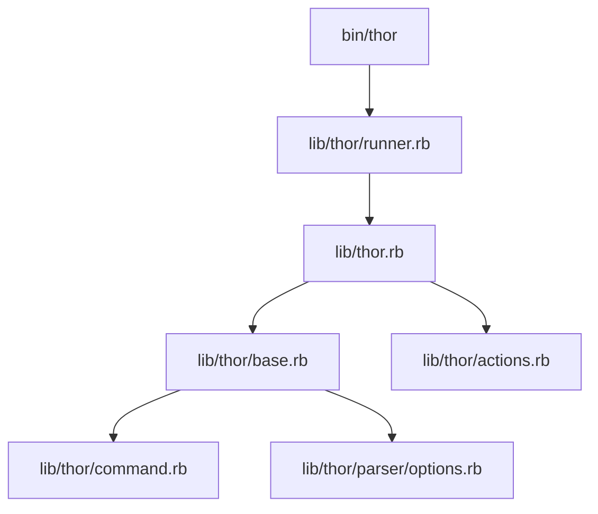

# rails/thor

> Ruby library for building self-documenting command-line tools, an alternative to Rake.

## The problem
Parsing command-line options and writing help banners by hand is repetitive.

## What it actually does
You declare classes inheriting from `Thor`; each command becomes a subcommand with its parsed options and generated help. The syntax resembles Rake's. `actions.rb` provides file operations and `shell/color.rb` handles colored output. The `bin/thor` launcher loads these classes.

## How it is wired


## Trying it
```bash
gem install thor
```

## Cost and gotchas
Free, Ruby required. The README warns: Thor is a system tool and must not receive input from application users, because `open-uri` opens the door to command injection.

## What it is not
It is not a tool for exposed web applications. It only serves the Ruby ecosystem.

## Alternatives
Rake is cited: Thor borrows its syntax as an alternative.

## For you
Ignore: a command-line tool for Ruby; in Python, you use an equivalent from your own ecosystem.
