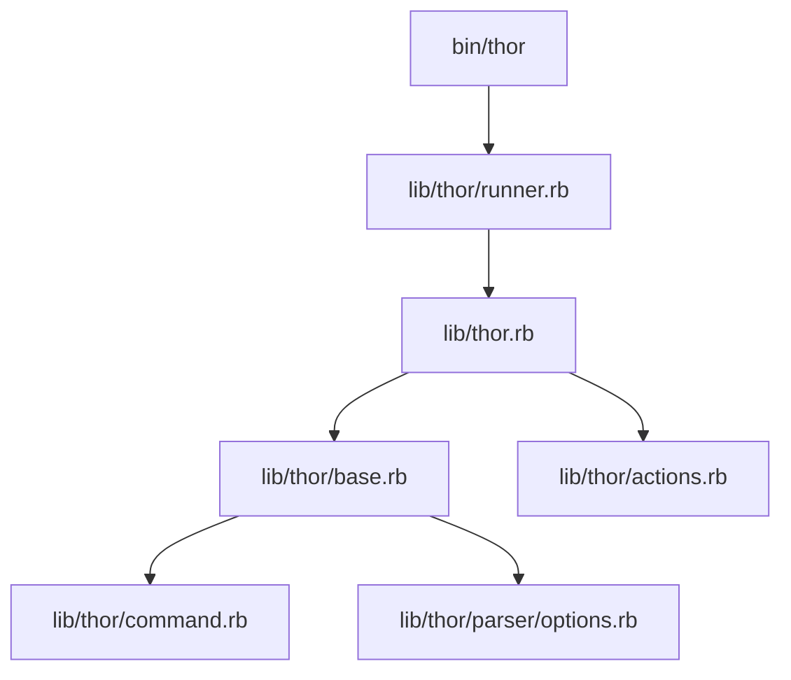

# rails/thor

> Bibliothèque Ruby pour créer des outils en ligne de commande auto-documentés, alternative à Rake.

## Le problème
Analyser les options de la ligne de commande et écrire les bannières d'aide à la main est répétitif.

## Ce que ça fait vraiment
On déclare des classes héritant de `Thor` ; chaque commande devient une sous-commande avec ses options analysées et son aide générée. La syntaxe ressemble à celle de Rake. `actions.rb` apporte des opérations de fichiers et `shell/color.rb` l'affichage en couleur. Le lanceur `bin/thor` charge ces classes.

## Comment c'est branché


## Essayer
```bash
gem install thor
```

## Coût et pièges
Gratuit, Ruby requis. Le README avertit : Thor est un outil système, il ne doit pas recevoir d'entrées d'utilisateurs d'application, car `open-uri` ouvre une porte à l'injection de commandes.

## Ce que ce n'est pas
Ce n'est pas un outil pour applications web exposées. Il ne sert qu'à l'écosystème Ruby.

## Alternatives
Rake est cité : Thor en reprend la syntaxe comme alternative.

## Pour toi
À ignorer : outil en ligne de commande pour Ruby ; en Python, tu utilises un équivalent de ton écosystème.

