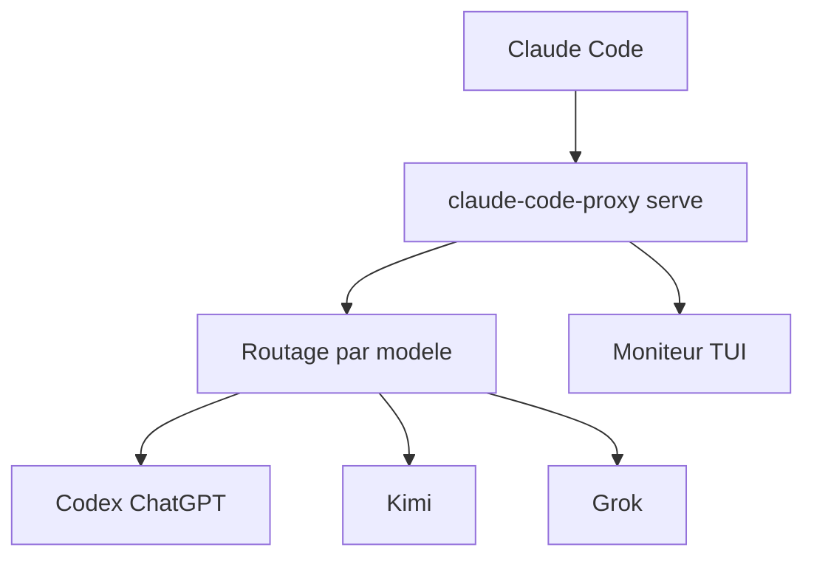

# raine/claude-code-proxy

> Local proxy that lets you use Claude Code with Codex, Kimi, Grok, OpenCode Go or Cursor subscriptions.

## The problem
Claude Code only speaks the Anthropic API, while you may already pay for subscriptions with other providers.

## What it actually does
A local process translates Anthropic traffic to the chosen provider, handles authentication and per-model routing. A terminal monitor displays sessions, errors, tokens and throughput. Optional image API reusing the ChatGPT login.

## How it is wired


## Trying it
```bash
brew install raine/claude-code-proxy/claude-code-proxy
claude-code-proxy codex auth login
claude-code-proxy serve
ANTHROPIC_BASE_URL=http://127.0.0.1:18765 ANTHROPIC_AUTH_TOKEN=unused claude
```

## Cost and gotchas
Requires a subscription with the provider (ChatGPT Plus or Pro, not an API key). The proxy accepts local requests without authentication: never expose it beyond `127.0.0.1`. Unofficial clients risk an account sanction.

## What it is not
Not an enterprise gateway nor a way to get free access. The terms of use remain those of each provider.

## Alternatives
No alternative cited in the README.

## For you
Worth watching: interesting for trying other models in Claude Code, but the risk to subscription accounts is real.
