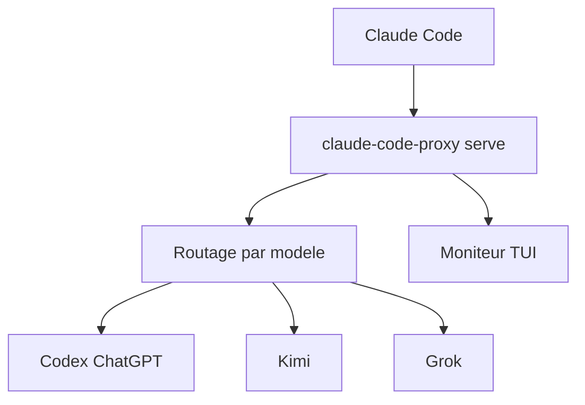

# raine/claude-code-proxy

> Proxy local qui permet d'utiliser Claude Code avec des abonnements Codex, Kimi, Grok, OpenCode Go ou Cursor.

## Le problème
Claude Code ne parle que l'API Anthropic, alors qu'on peut déjà payer des abonnements chez d'autres fournisseurs.

## Ce que ça fait vraiment
Un processus local traduit le trafic Anthropic vers le fournisseur choisi, gère l'authentification et le routage par modèle. Un moniteur en terminal affiche sessions, erreurs, tokens et débit. Option d'API d'images réutilisant la connexion ChatGPT.

## Comment c'est branché


## Essayer
```bash
brew install raine/claude-code-proxy/claude-code-proxy
claude-code-proxy codex auth login
claude-code-proxy serve
ANTHROPIC_BASE_URL=http://127.0.0.1:18765 ANTHROPIC_AUTH_TOKEN=unused claude
```

## Coût et pièges
Demande un abonnement chez le fournisseur (ChatGPT Plus ou Pro, pas une clé d'API). Le proxy accepte les requêtes locales sans authentification : ne jamais l'exposer hors de `127.0.0.1`. Les clients non officiels risquent une sanction du compte.

## Ce que ce n'est pas
Pas une passerelle d'entreprise ni un moyen d'accès gratuit. Les conditions d'usage restent celles de chaque fournisseur.

## Alternatives
Aucune alternative citée dans le README.

## Pour toi
À surveiller : intéressant pour tester d'autres modèles dans Claude Code, mais le risque sur les comptes d'abonnement est réel.

