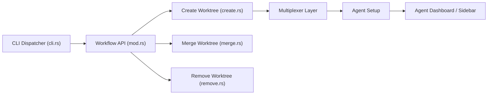

# raine/workmux

> CLI that ties git worktrees to tmux windows to run several coding agents in parallel without conflicts.

## The problem
Having several agents work on the same repo requires creating worktrees, copying `.env`, installing, opening windows, then cleaning everything up by hand.

## What it actually does
`workmux add` creates a worktree and a tmux window with your pane layout, copies or links files, and runs `post_create` hooks. `workmux merge` merges and removes the worktree, window and branch. A dashboard and a sidebar track agent state (Claude Code, Codex, Gemini, OpenCode…). Container/Lima sandbox options, LLM-generated branch name.

## How it is wired


## Trying it
```bash
brew install raine/workmux/workmux
workmux init
workmux add new-feature
workmux merge
```

## Cost and gotchas
The tool is free; the agents it launches consume your key or subscription. It requires tmux (or WezTerm, kitty, Zellij, experimental). The `curl | bash` is presented as "YOLO". The README stresses fighting port conflicts and `node_modules` issues.

## What it is not
Not a graphical interface, and worktrees do not prevent merge conflicts. Does not replace an agent orchestrator: it manages the environment, not the task.

## Alternatives
- claude-squad: TUI dedicated to agents.
- vibe-kanban: kanban board to drive agents.
- wtp: worktree management only, without tmux.

## For you
Adopt: you already work with worktrees and Claude Code, and a one-command `add`/`merge` lowers the cost of parallelizing agents.
