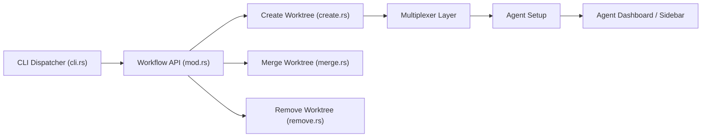

# raine/workmux

> CLI qui lie git worktrees et fenêtres tmux pour lancer plusieurs agents de code en parallèle sans conflit.

## Le problème
Faire travailler plusieurs agents sur un même dépôt exige de créer des worktrees, copier `.env`, installer, ouvrir des fenêtres, puis tout nettoyer à la main.

## Ce que ça fait vraiment
`workmux add` crée un worktree et une fenêtre tmux avec ta disposition de panneaux, copie ou lie des fichiers, exécute des hooks `post_create`. `workmux merge` fusionne et supprime worktree, fenêtre et branche. Un tableau de bord et une barre latérale suivent l'état des agents (Claude Code, Codex, Gemini, OpenCode…). Options de sandbox conteneur/Lima, nom de branche généré par LLM.

## Comment c'est branché


## Essayer
```bash
brew install raine/workmux/workmux
workmux init
workmux add new-feature
workmux merge
```

## Coût et pièges
L'outil est gratuit ; les agents lancés consomment ta clé ou ton abonnement. Il faut tmux (ou WezTerm, kitty, Zellij, expérimentaux). Le `curl | bash` est présenté comme « YOLO ». Le README insiste sur la lutte contre les conflits de ports et `node_modules`.

## Ce que ce n'est pas
Pas une interface graphique, et les worktrees n'évitent pas les conflits de merge. Ne remplace pas un orchestrateur d'agents : il gère l'environnement, pas la tâche.

## Alternatives
- claude-squad : interface TUI dédiée aux agents.
- vibe-kanban : tableau kanban pour piloter des agents.
- wtp : gestion de worktrees seule, sans tmux.

## Pour toi
À adopter : tu travailles déjà en worktrees avec Claude Code, et un `add`/`merge` en une commande réduit le coût de la parallélisation d'agents.

