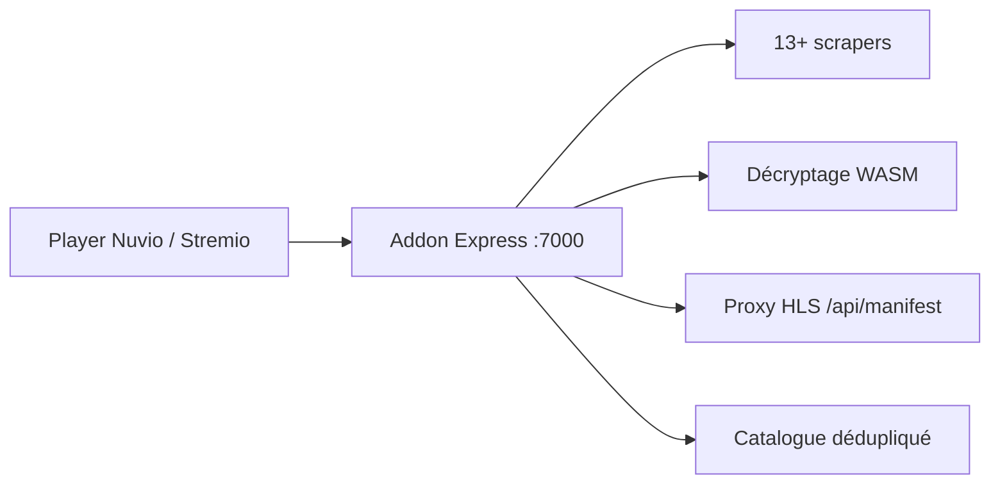

# rajhodedara/live-sport-plugin

> Addon Stremio et Nuvio qui agrège des flux sportifs en direct et des rediffusions issus de sources tierces.

## Le problème
Retrouver les flux et rediffusions d'un match dispersés sur de nombreux sites.

## Ce que ça fait vraiment
Serveur Node/Express qui interroge plus de 13 scrapers, fusionne les matchs en un catalogue, classe les flux (résolution, latence) et réécrit les manifestes HLS par un proxy. Des modules WebAssembly déchiffrent les jetons de flux protégés. Fonctions : disjoncteurs Opossum, garde SSRF, interface `/configure`.

## Comment c'est branché
Schéma simplifié d'après la fiche, sans diagramme fourni.


## Essayer
```bash
git clone https://github.com/rajhodedara/live-sport-plugin.git
cd live-sport-plugin
docker compose up -d
```

## Coût et pièges
Gratuit, mais l'auteur déconseille Render, Vercel et Railway : suspension de compte probable pour scraping. Le catalogue annonce MIT dans le texte alors que GitHub ne détecte aucune licence. Les flux viennent de sources non officielles, donc un risque juridique à ta charge.

## Ce que ce n'est pas
Ce n'est pas un service légal de diffusion sportive. Le contournement de protections de flux tiers pose un problème de droit d'auteur. Les dons sont demandés en cryptomonnaie.

## Alternatives
Aucune alternative nommée dans le README.

## Pour toi
À ignorer : sans rapport avec data, IA ou MLOps, et exposé à un risque juridique par ses sources de flux non autorisées.

