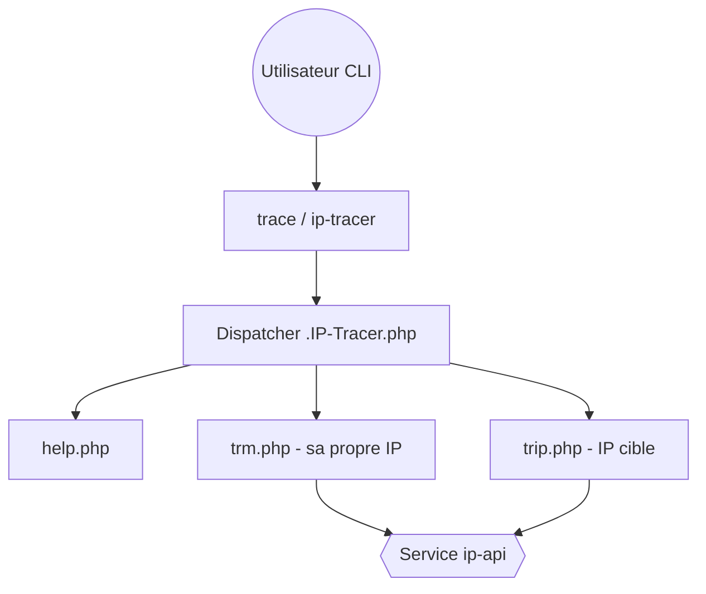

# rajkumardusad/IP-Tracer

> Petit outil en ligne de commande PHP qui géolocalise une adresse IP via ip-api, pour Termux et Linux.

## Le problème
Obtenir vite la localisation et les métadonnées réseau d'une adresse IP, sans ouvrir un site web ni écrire un appel d'API soi-même.

## Ce que ça fait vraiment
Deux commandes (`trace` et `ip-tracer`) passent par un dispatcher PHP qui choisit l'aide, la recherche de sa propre IP ou celle d'une IP cible. Chaque module interroge le service ip-api, met en forme localisation et infos réseau, puis affiche le résultat ou l'échec. Pas de base de données : la collecte et l'affichage sont dans le même module.

## Comment c'est branché
Schéma d'après le diagramme fourni, réduit.



## Essayer
```bash
apt update
apt install git -y
git clone https://github.com/rajkumardusad/IP-Tracer.git
cd IP-Tracer
chmod +x install
sh install
trace -m
trace -t 127.0.0.1
```

## Coût et pièges
Gratuit, rien à payer. Chaque requête part vers ip-api : l'IP interrogée est donc transmise à un tiers. Le README précise que le projet n'est plus activement maintenu (dernier push en septembre 2024).

## Ce que ce n'est pas
Ce n'est pas un outil d'investigation réseau : un simple appel à une API publique de géolocalisation, dont la précision dépend d'elle. Il n'y a ni historique, ni export, ni test documenté. L'installation est un script maison exécuté sur ta machine.

## Alternatives
Aucune alternative nommée dans le README.

## Pour toi
À ignorer : un wrapper de quelques fichiers autour d'une API publique, abandonné, que tu remplaces par un `curl` ou quelques lignes de Python, sans dépendance à PHP.

