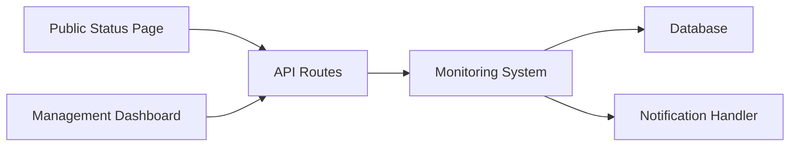

# rajnandan1/kener

> Lightweight status page system in SvelteKit, for teams wanting a sober service.

## The problem
Publishing a service's status and its incidents without a heavy tool like Datadog or Atlassian.

## What it actually does
Monitors API, ping, TCP, DNS, SSL, SQL, heartbeat, GameDig. Incidents, maintenances, notifications (email, webhook, Slack, Discord), branded pages, badges, REST API, team roles, multiple pages per instance.

## How it is wired


## Trying it
```bash
git clone https://github.com/rajnandan1/kener.git
cd kener
docker compose up -d
```
Then `http://localhost:3000`; set `KENER_SECRET_KEY` and `ORIGIN` before the first start.

## Cost and gotchas
Free. Redis required; Node >= 24.14 outside Docker.

## What it is not
Not a full monitoring tool: it does not replace Datadog.

## Alternatives
No alternative cited in the README.

## For you
Worth watching: handy for exposing the health of an internal ML service, self-hosted in a few minutes.
