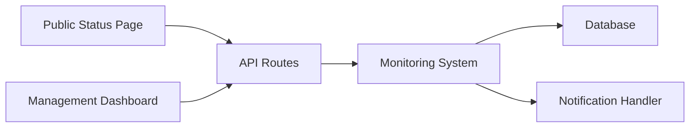

# rajnandan1/kener

> Système de page de statut léger en SvelteKit, pour équipes voulant un service sobre.

## Le problème
Publier l'état d'un service et ses incidents sans outil lourd comme Datadog ou Atlassian.

## Ce que ça fait vraiment
Surveille API, ping, TCP, DNS, SSL, SQL, heartbeat, GameDig. Incidents, maintenances, notifications (email, webhook, Slack, Discord), pages de marque, badges, API REST, rôles d'équipe, plusieurs pages par instance.

## Comment c'est branché


## Essayer
```bash
git clone https://github.com/rajnandan1/kener.git
cd kener
docker compose up -d
```
Puis `http://localhost:3000` ; définir `KENER_SECRET_KEY` et `ORIGIN` avant le premier démarrage.

## Coût et pièges
Gratuit. Redis requis ; Node >= 24.14 hors Docker.

## Ce que ce n'est pas
Pas un outil de monitoring complet : il ne remplace pas Datadog.

## Alternatives
Aucune alternative citée dans le README.

## Pour toi
À surveiller : pratique pour exposer la santé d'un service ML interne, auto-hébergé en quelques minutes.

