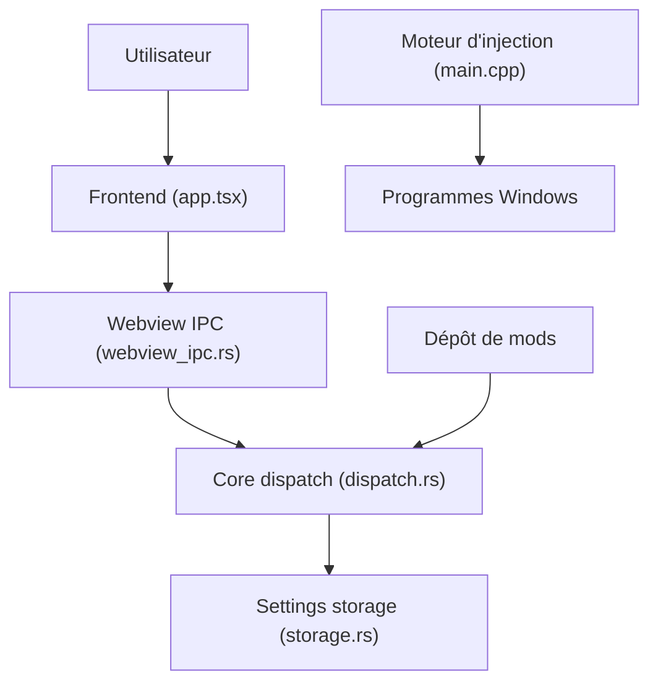

# ramensoftware/windhawk

> A Windows application that customises programs by injecting mods into them, for advanced users.

## The problem
Changing the behaviour or appearance of Windows programs without their source code is laborious.

## What it actually does
A C++ engine (`windhawk.exe`, `windhawk.dll`) injects code and places hooks in programs. A VS Code extension and a web interface install and manage mods, pulled from a separate mods repository. A Rust core handles commands, services and settings storage. The repository also serves as a discussion forum.

## How it is wired


## Trying it
```bash
# Aucune commande documentée : installeur officiel sur le site (non détaillé).
```

## Cost and gotchas
Free. Windows only. The README documents neither installation nor a precise build. 187 open issues.

## What it is not
Not a cross-platform tool. The repository does not contain the mods themselves (another repository, windhawk-mods).

## Alternatives
No alternative named in the README.

## For you
Ignore: Windows customisation, unrelated to data / AI / MLOps work.
