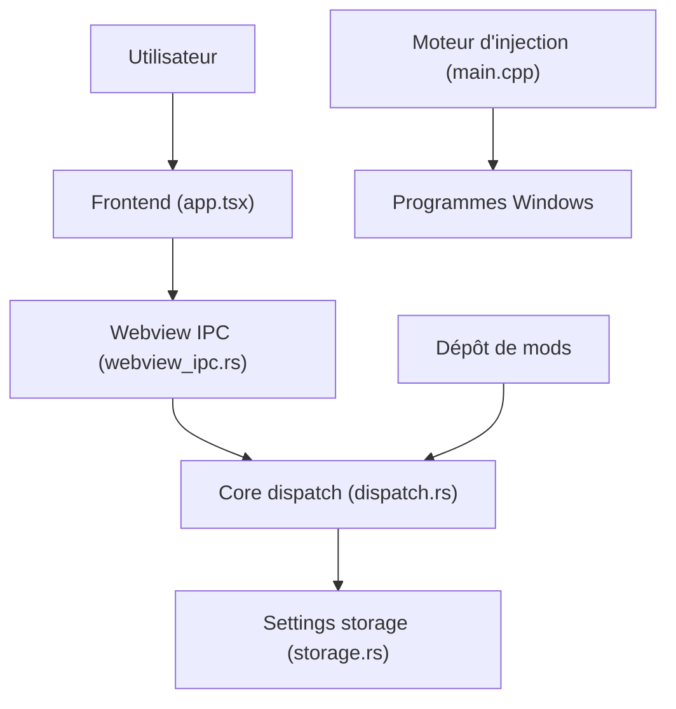

# ramensoftware/windhawk

> Application Windows qui personnalise les programmes en y injectant des mods, pour utilisateurs avancés.

## Le problème
Modifier le comportement ou l'apparence de programmes Windows sans leur code source est laborieux.

## Ce que ça fait vraiment
Un moteur C++ (`windhawk.exe`, `windhawk.dll`) injecte du code et pose des hooks dans les programmes. Une extension VS Code et une interface web installent et gèrent les mods, tirés d'un dépôt de mods séparé. Un cœur Rust assure commandes, services et stockage des réglages. Le dépôt sert aussi de forum de discussion.

## Comment c'est branché


## Essayer
```bash
# Aucune commande documentée : installeur officiel sur le site (non détaillé).
```

## Coût et pièges
Gratuit. Windows uniquement. Le README ne documente ni installation ni compilation précise. 187 issues ouvertes.

## Ce que ce n'est pas
Pas un outil multiplateforme. Le dépôt ne contient pas les mods eux-mêmes (autre dépôt, windhawk-mods).

## Alternatives
Aucune alternative nommée dans le README.

## Pour toi
À ignorer : personnalisation de Windows, sans lien avec un travail data / IA / MLOps.

