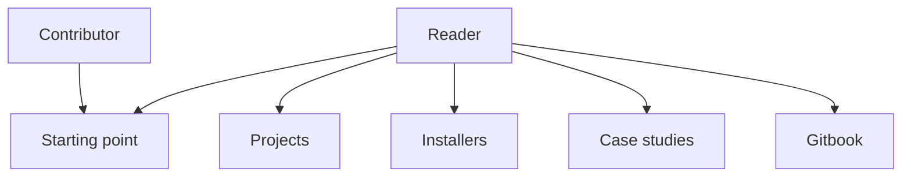

# ramitsurana/awesome-kubernetes

> List of Kubernetes resources: tutorials, books, projects, tools and case studies.

## The problem
Finding reliable resources to learn and practice Kubernetes.

## What it actually does
A curated list: starting point (articles, books, workshops), projects, applications, installers, managed Kubernetes, official resources, case studies. Also readable as a book via Gitbook. The README invites readers to report abandoned links.

## How it is wired
Simplified diagram based on the sheet.

## Trying it
No documented command.

## Cost and gotchas
Free. A license is present but not identified by GitHub. Many links may be outdated.

## What it is not
Not a structured course nor a tool: it is a directory of links, with no guarantee of freshness.

## Alternatives
No alternative named in the README.

## For you
Keep as a bookmark: useful for building Kubernetes skills on the MLOps side, nothing to install.
