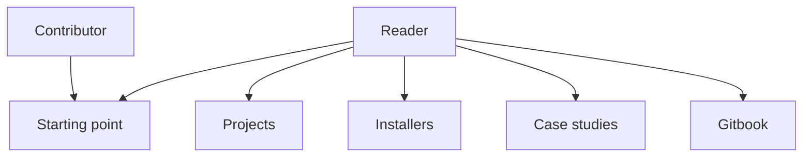

# ramitsurana/awesome-kubernetes

> Liste de ressources Kubernetes : tutoriels, livres, projets, outils et études de cas.

## Le problème
Trouver des ressources fiables pour apprendre et pratiquer Kubernetes.

## Ce que ça fait vraiment
Une liste commentée : point de départ (articles, livres, ateliers), projets, applications, installateurs, Kubernetes managé, ressources officielles, études de cas. Lisible aussi comme livre via Gitbook. Le README invite à signaler les liens abandonnés.

## Comment c'est branché
Schéma simplifié d'après la fiche.

## Essayer
Aucune commande documentée.

## Coût et pièges
Gratuit. Licence présente mais non identifiée par GitHub. Beaucoup de liens peuvent être périmés.

## Ce que ce n'est pas
Ce n'est pas un cours structuré ni un outil : c'est un annuaire de liens, sans garantie de fraîcheur.

## Alternatives
Aucune alternative nommée dans le README.

## Pour toi
À garder en marque-page : utile pour monter en compétence Kubernetes côté MLOps, rien à installer.

