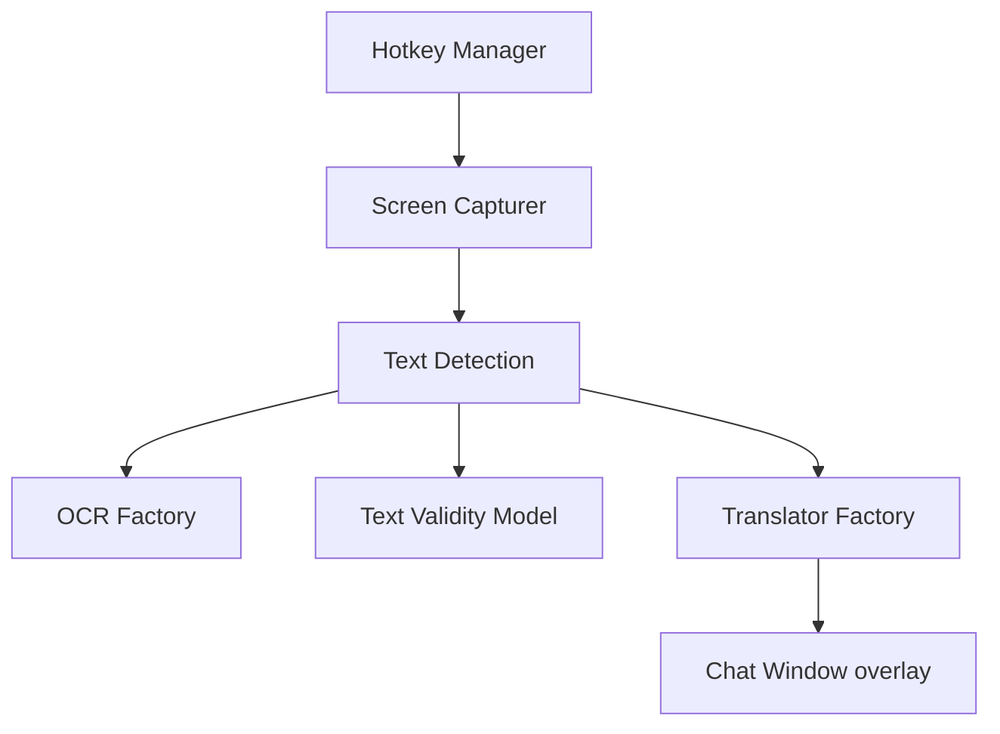

# ramjke/Translumo

> Real-time Windows screen translator using OCR, designed for games.

## The problem
Reading text displayed in a game or application with no translation forces you to copy each line elsewhere.

## What it actually does
You define a capture area, OCR engines (Windows OCR, EasyOCR, Tesseract in the code) read the text, a validity model picks the best result, then a translator (Google, DeepL, Yandex) shows the translation in an overlay window. Optional text-to-speech.

## How it is wired


## Trying it
```bash
git clone https://github.com/ramjke/Translumo.git
```
After downloading the archive: unzip and run `Translumo.exe`.

## Cost and gotchas
Free. Windows 10 2004+, DirectX 11 GPU. EasyOCR requires a CUDA 11.8 compatible NVIDIA GPU, 8 GB of RAM and 5 GB of disk. DeepL and Yandex require an API key. The captured text is sent to these services.

## What it is not
Not a cross-platform tool: Windows only. Fullscreen mode is not supported for display.

## Alternatives
Lookupper (on-screen dictionary, commercial Pro version), ScreTran, ScreenTranslator.

## For you
Ignore: Windows tool for games, of no interest for data / AI / MLOps work.
