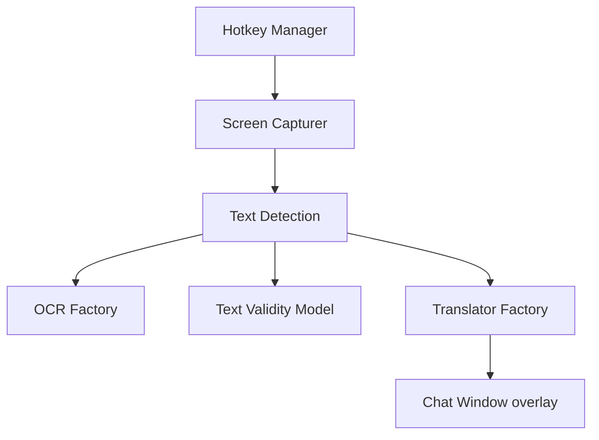

# ramjke/Translumo

> Traducteur d'écran Windows en temps réel par OCR, conçu pour les jeux.

## Le problème
Lire du texte affiché dans un jeu ou une application sans traduction oblige à copier chaque ligne ailleurs.

## Ce que ça fait vraiment
Tu définis une zone de capture, des moteurs OCR (Windows OCR, EasyOCR, Tesseract dans le code) lisent le texte, un modèle de validité choisit le meilleur résultat, puis un traducteur (Google, DeepL, Yandex) affiche la traduction dans une fenêtre superposée. Synthèse vocale optionnelle.

## Comment c'est branché


## Essayer
```bash
git clone https://github.com/ramjke/Translumo.git
```
Après téléchargement de l'archive : décompresser et lancer `Translumo.exe`.

## Coût et pièges
Gratuit. Windows 10 2004+, GPU DirectX 11. EasyOCR demande un GPU NVIDIA compatible CUDA 11.8, 8 Go de RAM et 5 Go de disque. DeepL et Yandex exigent une clé d'API. Le texte capturé part vers ces services.

## Ce que ce n'est pas
Pas un outil multiplateforme : Windows uniquement. Le mode plein écran n'est pas pris en charge pour l'affichage.

## Alternatives
Lookupper (dictionnaire d'écran, version Pro commerciale), ScreTran, ScreenTranslator.

## Pour toi
Ignorer : outil Windows pour jeux, sans intérêt pour un travail data / IA / MLOps.

