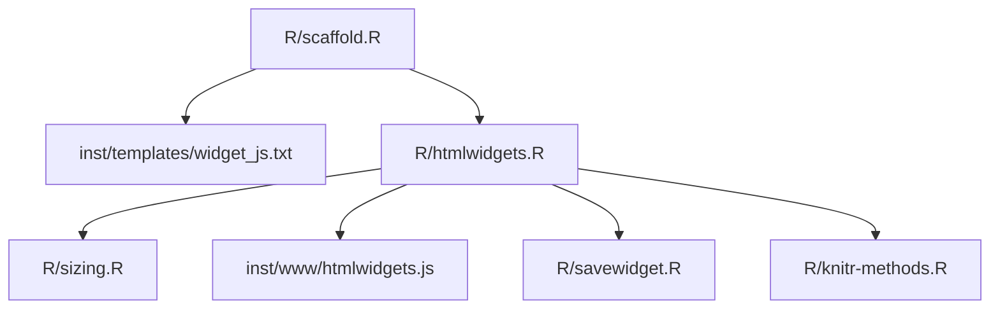

# ramnathv/htmlwidgets

> Framework for creating R bindings to JavaScript libraries, for R visualization developers.

## The problem
Connecting a JavaScript library to R, Shiny and R Markdown requires a lot of repeated binding code.

## What it actually does
`createWidget` assembles data, sizing policy and dependencies. The htmlwidgets.js runtime renders the widget in the browser, and savewidget.R or knitr-methods.R export it as a standalone page or into a document. It is the foundation of leaflet, dygraphs, DT, networkD3, sparkline and rthreejs.

## How it is wired


## Trying it
```r
install.packages("htmlwidgets")
devtools::install_github('ramnathv/htmlwidgets')
```

## Cost and gotchas
Free. You need R and a bit of JavaScript. The catalog flags a license that is present but not identified by GitHub: to be checked.

## What it is not
Not a ready-to-use charting tool: a framework for building widgets. No Python API.

## Alternatives
No alternative cited in the README.

## For you
Adopt if you do visualization in R: it is the common base of interactive widgets (DT, leaflet) in Shiny and R Markdown; otherwise of no interest.
