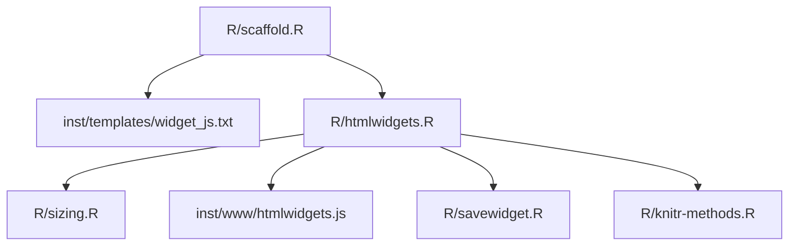

# ramnathv/htmlwidgets

> Cadre pour créer en R des liaisons vers des bibliothèques JavaScript, pour développeurs de visualisations R.

## Le problème
Brancher une bibliothèque JavaScript sur R, Shiny et R Markdown demande beaucoup de code de liaison répété.

## Ce que ça fait vraiment
`createWidget` assemble données, politique de taille et dépendances. Le runtime htmlwidgets.js rend le widget dans le navigateur, et savewidget.R ou knitr-methods.R l'exportent en page autonome ou dans un document. Il sert de base à leaflet, dygraphs, DT, networkD3, sparkline et rthreejs.

## Comment c'est branché


## Essayer
```r
install.packages("htmlwidgets")
devtools::install_github('ramnathv/htmlwidgets')
```

## Coût et pièges
Gratuit. Il faut R et un peu de JavaScript. Le catalogue signale une licence présente mais non identifiée par GitHub : à vérifier.

## Ce que ce n'est pas
Pas un outil de graphiques prêt à l'emploi : un cadre pour construire des widgets. Aucune API Python.

## Alternatives
Aucune alternative citée dans le README.

## Pour toi
Adopter si tu fais de la visualisation en R : c'est la base commune des widgets interactifs (DT, leaflet) dans Shiny et R Markdown ; sinon sans intérêt.

