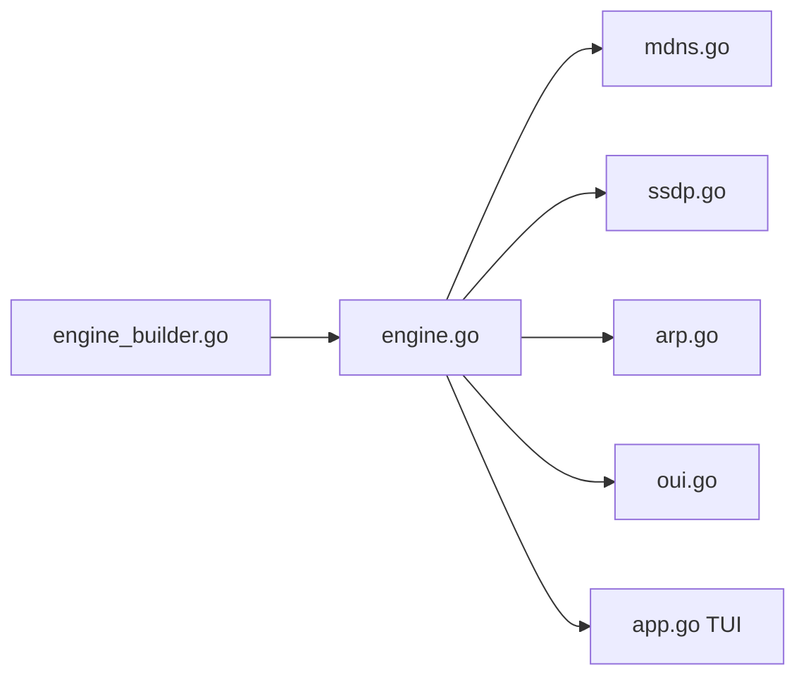

# ramonvermeulen/whosthere

> Go tool with a terminal interface that discovers devices on a local network, without privileges.

## The problem
Knowing what is connected to the local network often requires administrator rights or heavy tools.

## What it actually does
Three concurrent scanners (mDNS, SSDP, ARP) plus a subnet sweep that fills the ARP cache; manufacturers are looked up by OUI. TUI interface with regex search, one-off CLI scan with JSON output, daemon mode with an HTTP API (`/devices`, `/device/{ip}`, `/health`), optional port scanner and persistent aliases.

## How it is wired


## Trying it
```bash
brew install whosthere
whosthere
whosthere scan -t 5 --json --pretty > devices.json
whosthere daemon --port=8080
```

## Cost and gotchas
Free. Use only on authorized networks; the clipboard needs a copy tool depending on the OS.

## What it is not
Not a professional monitoring tool: the author says so, results may be incomplete.

## Alternatives
No alternative named in the README.

## For you
Worth watching: handy for inventorying a home or lab network, no stake for your data work.
