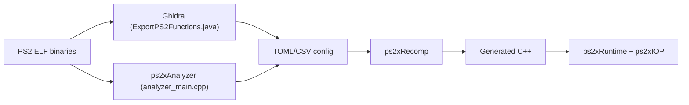

# ran-j/PS2Recomp

> A static recompiler that converts PlayStation 2 ELF binaries into C++ with a runtime, for porting.

## The problem
Emulating a PS2 game remains slow and opaque; a native port requires rewriting the MIPS machine code by hand.

## What it actually does
`ps2xAnalyzer` scans the ELF and writes a TOML (stubs, skips, patches). `ps2xRecomp` decodes R5900 instructions and generates literal C++ (one MIPS instruction = one C++ operation). `ps2xRuntime` provides guest memory, a function table and syscalls; `ps2xIOP` runs IRX modules. The recommended path goes through a Ghidra export. Performance is "very poor" on VU and GS, hardware is partially emulated.

## How it is wired


## Trying it
```bash
git clone --recurse-submodules https://github.com/ran-j/PS2Recomp.git
cd PS2Recomp
cmake -S . -B out/build
cmake --build out/build --config Debug
./ps2_recomp config.toml
```

## Cost and gotchas
Free. CMake 3.20+, C++20 compiler (mostly tested with MSVC), SSE4/AVX. You must own a game and extract its ELF; the README forbids putting a game file in a repository. Each game requires manual work (stubs, overrides).

## What it is not
Not a ready-to-play emulator, nor a tool to "just run": it is a per-title working base. GPL-3.0.

## Alternatives
- N64Recomp: the project PS2Recomp draws inspiration from, for the Nintendo 64.
- PCSX2: emulator serving as a reference for the runtime.

## For you
Ignore: game reverse engineering, with no link to data or AI, and each port requires significant manual work.
