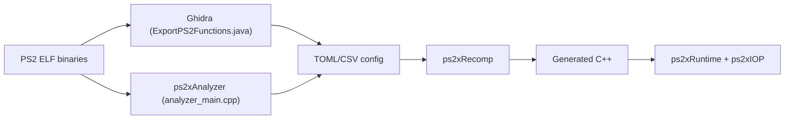

# ran-j/PS2Recomp

> Recompilateur statique qui convertit des binaires ELF PlayStation 2 en C++ avec un runtime, pour portage.

## Le problème
Émuler un jeu PS2 reste lent et opaque ; un portage natif demande de réécrire le code machine MIPS à la main.

## Ce que ça fait vraiment
`ps2xAnalyzer` scanne l'ELF et écrit un TOML (stubs, skips, patches). `ps2xRecomp` décode les instructions R5900 et génère du C++ littéral (une instruction MIPS = une opération C++). `ps2xRuntime` fournit mémoire invitée, table de fonctions et syscalls ; `ps2xIOP` exécute les modules IRX. Le chemin recommandé passe par un export Ghidra. Performances « très mauvaises » sur VU et GS, matériel partiellement émulé.

## Comment c'est branché


## Essayer
```bash
git clone --recurse-submodules https://github.com/ran-j/PS2Recomp.git
cd PS2Recomp
cmake -S . -B out/build
cmake --build out/build --config Debug
./ps2_recomp config.toml
```

## Coût et pièges
Gratuit. CMake 3.20+, compilateur C++20 (testé surtout avec MSVC), SSE4/AVX. Il faut posséder un jeu et extraire son ELF ; le README interdit de mettre un fichier de jeu dans un dépôt. Chaque jeu demande un travail manuel (stubs, overrides).

## Ce que ce n'est pas
Pas un émulateur prêt à jouer, ni un outil à « lancer » : c'est une base de travail par titre. GPL-3.0.

## Alternatives
- N64Recomp : projet dont PS2Recomp s'inspire, pour la Nintendo 64.
- PCSX2 : émulateur servant de référence pour le runtime.

## Pour toi
À ignorer : rétro-ingénierie de jeux, sans lien avec les données ou l'IA, et chaque portage demande un travail manuel important.

