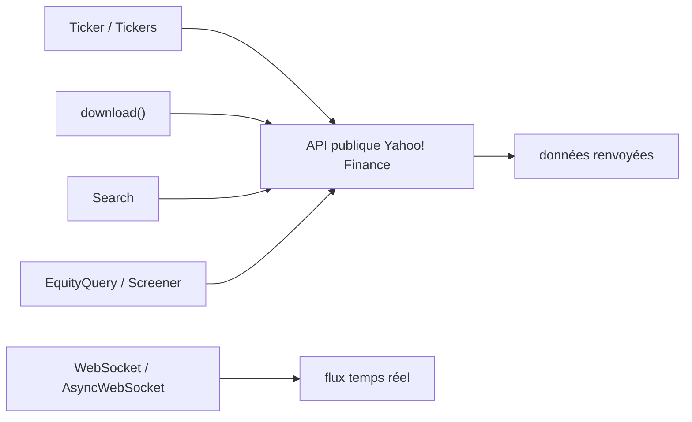

# ranaroussi/yfinance

> Python access to Yahoo! Finance market data, for research and learning.

## The problem
Reliable market data sits behind expensive subscriptions or APIs with tight quotas.
Manually downloading histories for several tickers quickly turns into a chore of throwaway scripts.

## What it actually does
`Ticker` for one security, `Tickers` for several, `download` to fetch market data in bulk.
`Market` reports on a marketplace; `Sector` and `Industry` give sector information.
`Search` returns quotes and news; `EquityQuery` and `Screener` build stock selection filters.
`WebSocket` and `AsyncWebSocket` for live data streams.

## How it is wired


## Trying it
```bash
pip install yfinance
```

## Cost and gotchas
Free, no key: the cost is fragility, since it relies on public, non-contractual APIs.
Installation without `curl_cffi` (request fallback) is documented separately, in the Advanced section.

## What it is not
It is not a Yahoo product: the project is neither affiliated with, endorsed by, nor vetted by Yahoo, Inc.
It is not a data source for a product: Yahoo's terms target personal use, and the project presents itself as intended for research and education.
It is not an availability guarantee: no API stability is promised upstream.

## Alternatives
No alternative named in the README.

## For you
Perfect for prototyping a financial time series; replace it with a contracted provider as soon as it leaves the sandbox.
