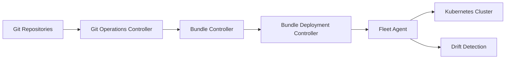

# rancher/fleet

> GitOps and HelmOps controller to deploy YAML, Helm or Kustomize across many Kubernetes clusters.

## The problem
Deploying and auditing the same applications across many clusters or teams becomes unmanageable by hand.

## What it actually does
Watches Git repositories (`GitRepo` resource), turns any source (raw YAML, Helm, Kustomize) into a Helm chart, then an agent per cluster deploys via Helm, detects drift and reports status. Controllers for bundles, clusters, groups, HelmOps and image scanning. Also works on a single cluster.

## How it is wired


## Trying it
```bash
helm -n cattle-fleet-system install --create-namespace --wait fleet-crd https://github.com/rancher/fleet/releases/download/v0.16.1/fleet-crd-0.16.1.tgz
helm -n cattle-fleet-system install --create-namespace --wait fleet https://github.com/rancher/fleet/releases/download/v0.16.1/fleet-0.16.1.tgz
kubectl apply -f example.yaml
kubectl -n fleet-local get fleet
```

## Cost and gotchas
Kubernetes cluster and Helm 3 required; 173 open issues. The README does not detail security or scaling.

## What it is not
Not an MLOps tool in itself: it deploys manifests, it manages neither models nor data pipelines.

## Alternatives
No alternative named in the README.

## For you
Worth watching: useful if you deploy ML platforms across several clusters; superfluous for a single simple environment.
