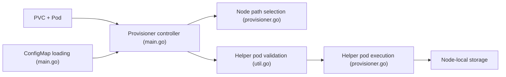

# rancher/local-path-provisioner

> Kubernetes provisioner that dynamically creates hostPath or local volumes on nodes, for cluster admins.

## The problem
Kubernetes' native local volume provisioner cannot do dynamic provisioning: you have to create PVs by hand.

## What it actually does
A daemon reads a ConfigMap (`config.json`, `setup`, `teardown`, `helperPod.yaml`), then, for each PVC, picks a path per node and launches a helper pod that creates or deletes the volume directory. The type (`hostPath` or `local`) is set by annotation. A `sharedFileSystemPath` also allows RWX modes. The config is hot-reloaded; on error, the last valid config stays in use.

## How it is wired


## Trying it
```bash
kubectl apply -f https://raw.githubusercontent.com/rancher/local-path-provisioner/v0.0.37/deploy/local-path-storage.yaml
kubectl create -f https://raw.githubusercontent.com/rancher/local-path-provisioner/master/examples/pvc/pvc.yaml
kubectl create -f https://raw.githubusercontent.com/rancher/local-path-provisioner/master/examples/pod/pod.yaml
kubectl get pv
```

## Cost and gotchas
Free, Kubernetes v1.12+ required. The helper pod is validated by default; the `--allow-unsafe-helper-pod-template` option disables these safeguards.

## What it is not
Not replicated storage: data stays on a single node (affinity on `kubernetes.io/hostname` by default). The requested capacity limit is ignored for now.

## Alternatives
- Native Kubernetes Local Persistent Volume: built in, but without dynamic provisioning.

## For you
Adopt it for a dev cluster or a homelab where a local volume is enough; unsuitable if you need replication or capacity quotas.
