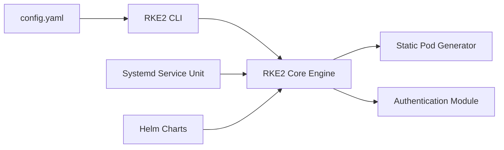

# rancher/rke2

> Rancher's Kubernetes distribution, focused on security and compliance, for infrastructure operators.

## The problem
Hardening a Kubernetes cluster to pass the CIS benchmark, FIPS and SELinux requires a lot of manual configuration.

## What it actually does
RKE2 ("RKE Government") is a conformant Kubernetes distribution, with defaults that let it pass the CIS Benchmark with little intervention. It enables FIPS 140-2, handles SELinux and MCS, and scans components with trivy in the build pipeline. Installed as a systemd service, configured through `/etc/rancher/rke2/config.yaml`. Releases follow upstream Kubernetes (patches targeted within a week).

## How it is wired


## Trying it
```bash
curl -sfL https://get.rke2.io | sh -
systemctl enable rke2-server.service
systemctl start rke2-server.service
# Wait a bit
export KUBECONFIG=/etc/rancher/rke2/rke2.yaml PATH=$PATH:/var/lib/rancher/rke2/bin
kubectl get nodes
```

## Cost and gotchas
Free; requires a Linux machine and root rights for the systemd service. The installation script is fetched via `curl | sh`.

## What it is not
Not a data/AI tool: it is an infrastructure platform. Aimed at the US public sector, it is not the lightest option (the FAQ compares it with RKE1 and K3s).

## Alternatives
- K3s: cited in the FAQ as a comparison, with no detail in the README.
- RKE1: same.

## For you
Worth watching: solid if you operate clusters under compliance constraints for MLOps, useless for a data scientist's workstation.
