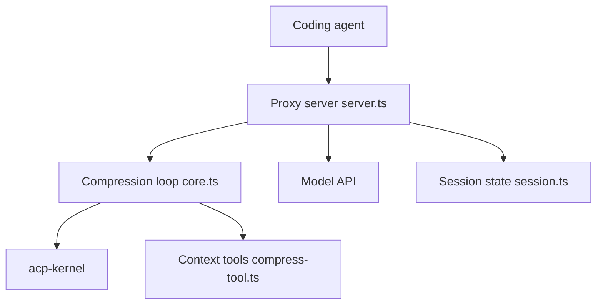

# ranxianglei/billion-context

> Proxy that compresses coding agents' context so sessions can last several days.

## The problem
Long coding sessions saturate the context window: token cost, degradation, lost session. The summarizers built into hosts break the prefix cache.

## What it actually does
A proxy sits between the agent and the API (Anthropic, OpenAI or compatible), rewrites the streams via acp-kernel and injects four tools: `compress`, `decompress`, `search_context`, `acp_status`. The model decides when and what to summarize; ranges remain restorable. Three modes: native plugin, launcher (`bili <client>`), `/bili/` URL prefix. The figures from the longitudinal study and benchmarks are the author's own. The supplied README is truncated at the end of the document.

## How it is wired


## Trying it
```bash
npm install -g billion-context --prefix=~/.local
bili claude
bili plugin install pi
curl -s http://localhost:8787/__bili/health
```

## Cost and gotchas
Provider API key at your expense. The MITM certificate mode intercepts TLS traffic for targeted domains. 757 open issues, many clients each with their own limits. Native plugins and standalone extensions are mutually exclusive (double compression).

## What it is not
Not a RAG nor a truncation. The Claude Desktop app bypasses the proxy (documented limitation #2290).

## Alternatives
The README compares against full context and three RAG arms (bm25, embedding, embedding-rerank).

## For you
Worth watching: the idea is useful if you run long agent sessions, but the license needs checking, and TLS interception plus a huge surface call for a cautious trial.
