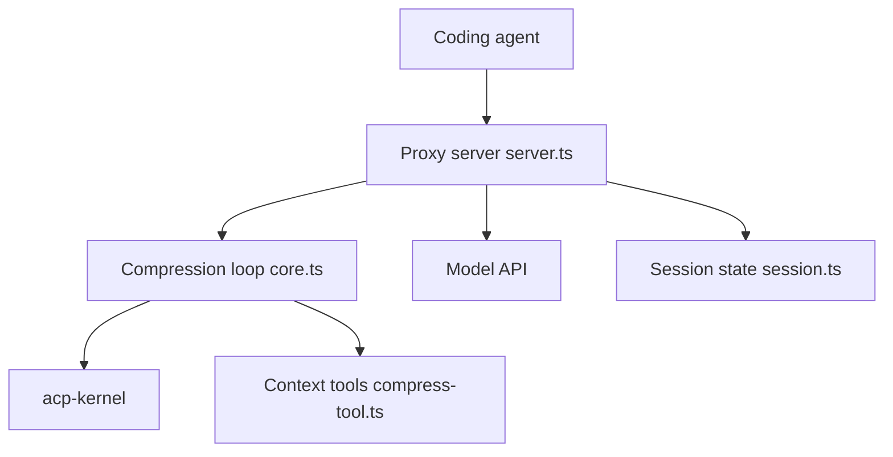

# ranxianglei/billion-context

> Proxy qui compresse le contexte des agents de code pour tenir des sessions de plusieurs jours.

## Le problème
Les longues sessions de code saturent la fenêtre de contexte : coût en tokens, dégradation, session perdue. Les résumeurs intégrés aux hôtes cassent le cache de préfixe.

## Ce que ça fait vraiment
Un proxy se place entre l'agent et l'API (Anthropic, OpenAI ou compatible), réécrit les flux via acp-kernel et injecte quatre outils : `compress`, `decompress`, `search_context`, `acp_status`. Le modèle décide quand et quoi résumer ; les plages restent restaurables. Trois modes : plugin natif, lanceur (`bili <client>`), préfixe d'URL `/bili/`. Les chiffres de l'étude longitudinale et des benchmarks sont ceux de l'auteur. Le README fourni est tronqué en fin de document.

## Comment c'est branché


## Essayer
```bash
npm install -g billion-context --prefix=~/.local
bili claude
bili plugin install pi
curl -s http://localhost:8787/__bili/health
```

## Coût et pièges
Clé d'API du fournisseur à ta charge. Le mode certificat MITM intercepte le trafic TLS de domaines ciblés. 757 issues ouvertes, de nombreux clients avec des limites propres. Les plugins natifs et extensions autonomes s'excluent (double compression).

## Ce que ce n'est pas
Pas un RAG ni une troncature. Le bureau Claude Desktop contourne le proxy (limite documentée #2290).

## Alternatives
Le README compare avec le contexte complet et trois bras RAG (bm25, embedding, embedding-rerank).

## Pour toi
À surveiller : l'idée est utile si tu fais de longues sessions d'agents, mais licence à vérifier, interception TLS et surface énorme appellent un essai prudent.

