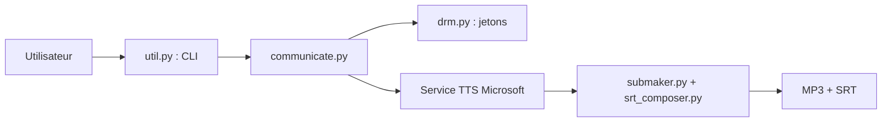

# rany2/edge-tts

> Python module and commands to use Microsoft Edge's online text-to-speech.

## The problem
Getting quality voice without an API key or a local GPU.

## What it actually does
Sends the text to the Microsoft Edge TTS service, receives the streamed audio plus timing markers, and writes an MP3 and SRT subtitles. Lets you choose the voice, rate, volume and pitch. `edge-playback` plays the result right away (requires `mpv`, except on Windows).

## How it is wired


## Trying it
```bash
pip install edge-tts
edge-tts --text "Hello, world!" --write-media hello.mp3 --write-subtitles hello.srt
edge-tts --list-voices
edge-playback --text "Hello, world!"
```

## Cost and gotchas
Free for the user, but the Microsoft service may change or restrict access. No key required. License "present but not identified by GitHub".

## What it is not
Not a local engine: without a network, nothing works. Custom SSML was removed because Microsoft only accepts what Edge generates.

## Alternatives
- No alternative named in the README.

## For you
Worth watching: handy for prototyping voice output (podcasts, demos) without a GPU, but it depends on a non-contractual service.
