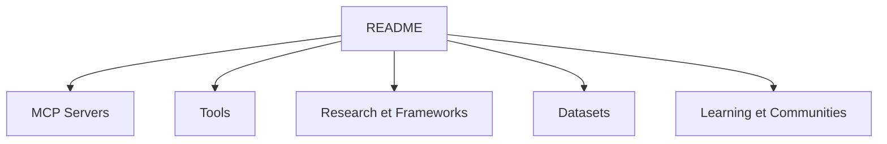

# raphabot/awesome-cybersecurity-agentic-ai

> Annotated list of tools, MCP servers and research on agentic AI applied to cybersecurity.

## The problem
Security tools for AI agents (guardrails, skill scanners, MCP servers) are scattered and evolve fast.

## What it actually does
A README split into sections: MCP Servers, Research, Tools, Frameworks, Datasets, Learning Resources, Communities. Each entry fits on one line with a link. It includes runtime guardrails, skill scanners to run before installation and pentest tools, both defensive and offensive.

## How it is wired


## Trying it
```bash
# Aucune commande : la liste se lit dans le README.
```

## Cost and gotchas
Free, nothing to install. Entries must be evaluated one by one: some are commercial (Barrion, Trent AI) or mere showcases.

## What it is not
Not an evaluation: the AgentShield Benchmark is maintained by the team whose product ranks first, which the README itself flags. Some entries are offensive tools.

## Alternatives
- awesome-ai-agents: general list of agents, cited in the README.

## For you
Watch: a good entry point for securing agents (guardrails, skill scanners), to browse when you deploy some.
