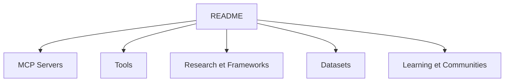

# raphabot/awesome-cybersecurity-agentic-ai

> Liste commentée d'outils, serveurs MCP et recherches sur l'IA agentique appliquée à la cybersécurité.

## Le problème
Les outils de sécurité pour agents IA (garde-fous, scanners de skills, serveurs MCP) sont dispersés et poussent vite.

## Ce que ça fait vraiment
Un README découpé en sections : Serveurs MCP, Recherche, Outils, Frameworks, Jeux de données, Ressources d'apprentissage, Communautés. Chaque entrée tient en une ligne avec lien. On y trouve des garde-fous d'exécution, des scanners de skills avant installation et des outils de pentest, côté défense comme côté offensif.

## Comment c'est branché


## Essayer
```bash
# Aucune commande : la liste se lit dans le README.
```

## Coût et pièges
Gratuit, rien à installer. Les entrées sont à évaluer une à une : certaines sont commerciales (Barrion, Trent AI) ou de simples vitrines.

## Ce que ce n'est pas
Pas une évaluation : l'AgentShield Benchmark est maintenu par l'équipe dont le produit arrive premier, ce que le README signale lui-même. Certaines entrées sont des outils offensifs.

## Alternatives
- awesome-ai-agents : liste générale d'agents, citée dans le README.

## Pour toi
Surveiller : bon point d'entrée pour sécuriser des agents (garde-fous, scanners de skills), à parcourir quand tu en déploies.

