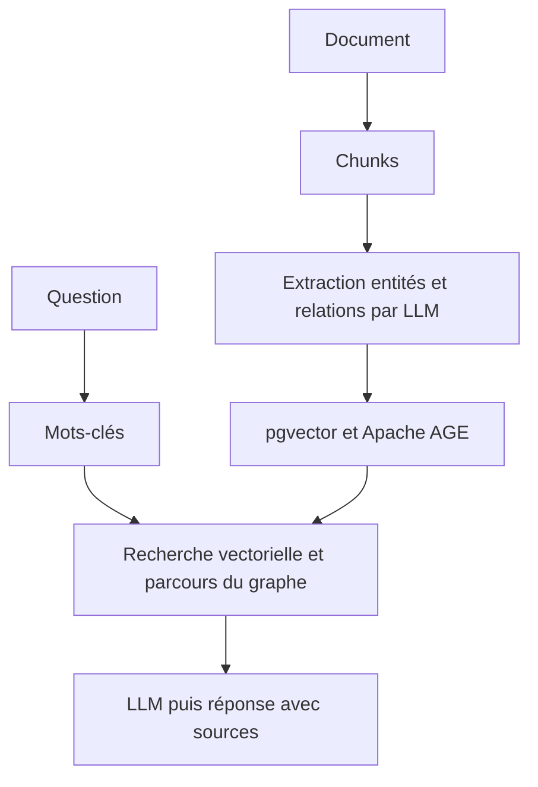

# raphaelmansuy/edgequake

> A Graph-RAG in Rust, a single binary and Postgres, to query your documents with sources.

## The problem
Vector search finds nearby text, but misses answers that lie in the relationships between entities. Building a knowledge graph by hand is expensive.

## What it actually does
Documents are chunked, an LLM extracts entities and relations from them, and everything is stored in Postgres (pgvector for embeddings, Apache AGE for the graph). At query time, EdgeQuake combines vector search and graph traversal, then answers with sources. Six query modes (naive, local, global, hybrid, mix, bypass), a web interface, a REST API, an MCP server and several SDKs. It is the LightRAG algorithm rewritten in Rust.

## How it is wired


## Trying it
```bash
curl -fsSL https://raw.githubusercontent.com/raphaelmansuy/edgequake/edgequake-main/quickstart.sh | sh
quickstart.sh --yes --provider ollama
curl -X POST http://localhost:8080/api/v1/documents/upload -F "file=@your-document.pdf"
curl -X POST http://localhost:8080/api/v1/query -H "Content-Type: application/json" -d '{"query": "What are the main concepts?", "mode": "hybrid"}'
```

## Cost and gotchas
Docker is mandatory. With a cloud provider, entity extraction consumes tokens at your expense; with Ollama, the first launch downloads several GB of models.

## What it is not
Not more accurate than LightRAG: the README itself publishes a statistical tie (0.792 versus 0.786) and lower evidence recall. The announced gain is industrialisation, not quality. The project is young and the schema evolves (explicit migrations).

## Alternatives
- LightRAG: the original algorithm in Python, same measured quality.
- Microsoft's GraphRAG: the reference cited that the project draws on.

## For you
Worth watching: if you want a deployable Graph-RAG with Postgres alone, it is a solid base, but quality is no better than LightRAG and the project is still young.
