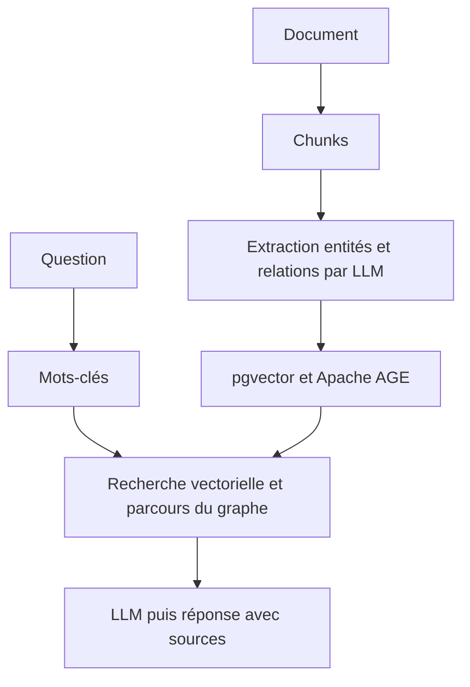

# raphaelmansuy/edgequake

> Un Graph-RAG en Rust, un seul binaire et Postgres, pour interroger ses documents avec sources.

## Le problème
La recherche vectorielle trouve du texte proche, mais rate les réponses qui tiennent dans les relations entre entités. Monter un graphe de connaissances à la main coûte cher.

## Ce que ça fait vraiment
Les documents sont découpés, un LLM en extrait entités et relations, le tout est stocké dans Postgres (pgvector pour les embeddings, Apache AGE pour le graphe). À la question, EdgeQuake combine recherche vectorielle et parcours du graphe, puis répond avec les sources. Six modes de requête (naive, local, global, hybrid, mix, bypass), interface web, API REST, serveur MCP et plusieurs SDK. C'est l'algorithme LightRAG réécrit en Rust.

## Comment c'est branché


## Essayer
```bash
curl -fsSL https://raw.githubusercontent.com/raphaelmansuy/edgequake/edgequake-main/quickstart.sh | sh
quickstart.sh --yes --provider ollama
curl -X POST http://localhost:8080/api/v1/documents/upload -F "file=@your-document.pdf"
curl -X POST http://localhost:8080/api/v1/query -H "Content-Type: application/json" -d '{"query": "What are the main concepts?", "mode": "hybrid"}'
```

## Coût et pièges
Docker obligatoire. Avec un fournisseur cloud, l'extraction d'entités consomme des jetons à ta charge ; avec Ollama, le premier lancement télécharge plusieurs Go de modèles.

## Ce que ce n'est pas
Pas plus précis que LightRAG : le README publie lui-même une égalité statistique (0,792 contre 0,786) et un rappel de preuves inférieur. Le gain annoncé est l'industrialisation, pas la qualité. Le projet est jeune et le schéma évolue (migrations explicites).

## Alternatives
- LightRAG : l'algorithme d'origine en Python, même qualité mesurée.
- GraphRAG de Microsoft : référence citée dont le projet s'inspire.

## Pour toi
À surveiller : si tu veux un Graph-RAG déployable avec Postgres seul, c'est une base sérieuse, mais la qualité n'est pas meilleure que LightRAG et le projet reste jeune.

