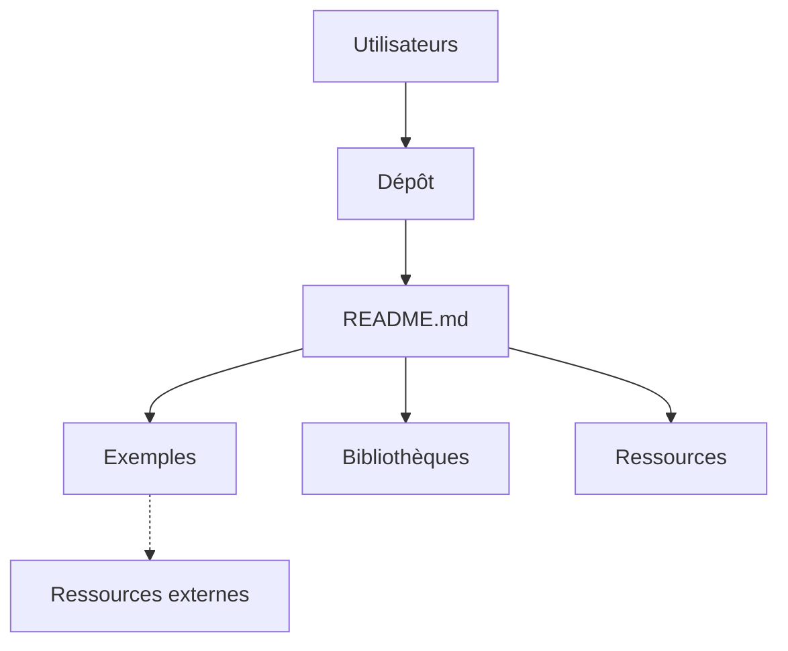

# raphamorim/awesome-canvas

> List of demos, libraries, books and tutorials around HTML5 Canvas.

## The problem
Finding good Canvas examples and libraries means digging through a scattered web.

## What it actually does
A README organized into definition, examples (particles, games, fractals), libraries (Chart.js, D3, Pixi.js, Konva, p5.js, Three.js), talks, books and tutorials. No code of its own.

## How it is wired


## Trying it
```bash
# Rien à installer : on lit le README.
```

## Cost and gotchas
Free. Many demos date from 2012 to 2015; some links may be dead, the README does not say so.

## What it is not
Not a library, not a step-by-step tutorial. The examples are not hosted here.

## Alternatives
No alternative named in the README.

## For you
Ignore: list focused on Canvas and creative web; Chart.js or D3 are cited, but you will find them more directly elsewhere.
