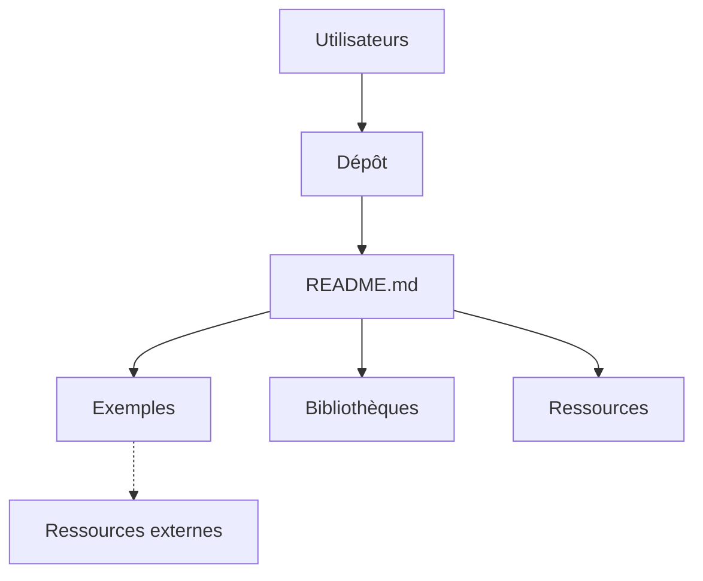

# raphamorim/awesome-canvas

> Liste de démos, bibliothèques, livres et tutoriels autour du Canvas HTML5.

## Le problème
Retrouver de bons exemples et bibliothèques Canvas demande de fouiller un web dispersé.

## Ce que ça fait vraiment
Un README classé en définition, exemples (particules, jeux, fractales), bibliothèques (Chart.js, D3, Pixi.js, Konva, p5.js, Three.js), conférences, livres et tutoriels. Pas de code propre.

## Comment c'est branché


## Essayer
```bash
# Rien à installer : on lit le README.
```

## Coût et pièges
Gratuit. Beaucoup de démos datent de 2012 à 2015 ; certains liens peuvent être morts, le README ne le dit pas.

## Ce que ce n'est pas
Pas une bibliothèque, pas un tutoriel suivi. Les exemples ne sont pas hébergés ici.

## Alternatives
Aucune alternative nommée dans le README.

## Pour toi
À ignorer : liste centrée sur le Canvas et le web créatif ; Chart.js ou D3 y sont cités, mais tu les trouveras plus directement ailleurs.

