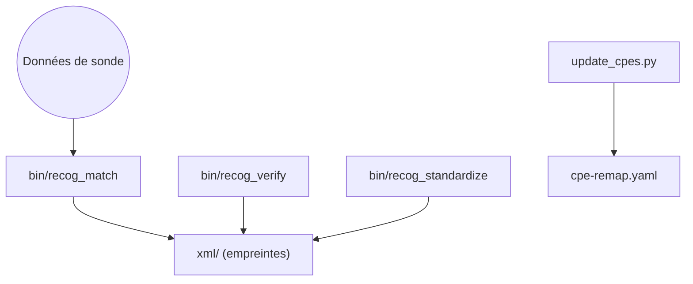

# rapid7/recog

> XML fingerprint database that identifies products, services and systems from network banners, for security and inventory.

## The problem
Raw network responses (SSH banner, HTTP header) do not directly tell which product and which version is running.

## What it actually does
XML fingerprint files: a regular expression, tested examples and extracted parameters (vendor, product, version, CPE). The `recog_match` tool compares probe data against these fingerprints. Verification, normalization and CPE update tools are provided; the Ruby, Java and Go implementations live in other repositories.

## How it is wired


## Trying it
```bash
git clone git@github.com:rapid7/recog.git
cd recog
bundle install
echo -n '220 Microsoft FTP Service' | bin/recog_match xml/ftp_banners.xml -
```

## Cost and gotchas
Free. Ruby 2.31+, Rubygems and bundler for the tools. The README warns that the Ruby code changes quickly: contact Rapid7 before production use.

## What it is not
Not a scanner: it identifies data you have already collected with nmap or curl. The fingerprints are stable, the Ruby code is not.

## Alternatives
recog-ruby, recog-java and recog-go, the library implementations cited by the README.

## For you
Watch: useful for enriching inventories or logs with product and version, otherwise out of scope.
