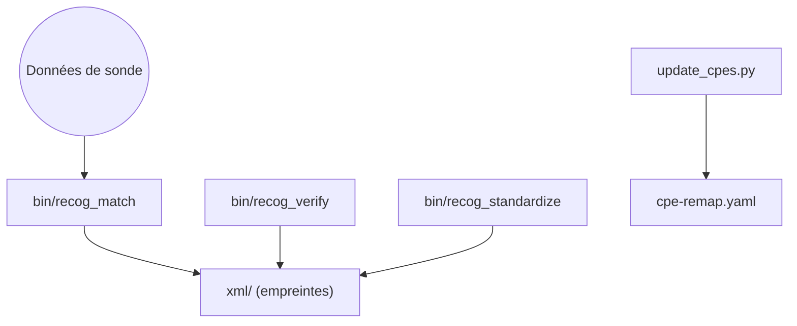

# rapid7/recog

> Base d'empreintes XML qui identifie produits, services et systèmes à partir de bannières réseau, pour sécurité et inventaire.

## Le problème
Des réponses réseau brutes (bannière SSH, en-tête HTTP) ne disent pas directement quel produit et quelle version tournent.

## Ce que ça fait vraiment
Des fichiers XML d'empreintes : une expression régulière, des exemples testés et des paramètres extraits (fournisseur, produit, version, CPE). L'outil `recog_match` compare une donnée de sonde à ces empreintes. Des outils de vérification, de normalisation et de mise à jour des CPE sont fournis ; les implémentations Ruby, Java et Go vivent dans d'autres dépôts.

## Comment c'est branché


## Essayer
```bash
git clone git@github.com:rapid7/recog.git
cd recog
bundle install
echo -n '220 Microsoft FTP Service' | bin/recog_match xml/ftp_banners.xml -
```

## Coût et pièges
Gratuit. Ruby 2.31+, Rubygems et bundler pour les outils. Le README prévient que le code Ruby change vite : contacter Rapid7 avant un usage en production.

## Ce que ce n'est pas
Pas un scanner : il identifie des données que tu as déjà collectées avec nmap ou curl. Les empreintes sont stables, pas le code Ruby.

## Alternatives
recog-ruby, recog-java et recog-go, les implémentations en bibliothèque citées par le README.

## Pour toi
Surveiller : utile pour enrichir des inventaires ou des journaux avec produit et version, sinon hors périmètre.

