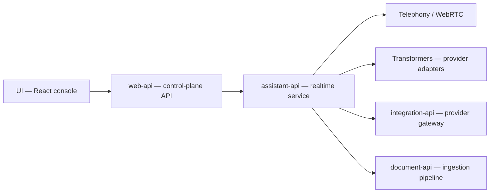

# rapidaai/voice-ai

> Open-source, self-hostable voice agent orchestration platform, for agencies and enterprises.

## The problem
Building a real-time voice agent means wiring up telephony, STT, LLM, TTS and observability by hand.

## What it actually does
Go backend (gRPC) in four services: web-api (control plane), assistant-api (real-time voice sessions, VAD, noise reduction, end-of-speech detection), endpoint-api and integration-api (provider gateway). A Python `document-api` service handles RAG ingestion. Telephony adapters (Twilio, Vonage, Telnyx, SIP, WebRTC) and a React console.

## How it is wired


## Trying it
```bash
git clone https://github.com/rapidaai/voice-ai.git && cd voice-ai
just setup-local build-all
just up-all
docker compose ps
```

## Cost and gotchas
16 GB of RAM or more, Docker, Just, Go 1.25.13 and Node 22 for `just ci`. The OpenAI, Anthropic, Deepgram, Twilio etc. keys go in YAML files. Without Docker: PostgreSQL, Redis and OpenSearch must be provided. The document-api service is flagged as deprecated in the CI pipeline.

## What it is not
Not a ready-to-use managed service: you operate everything. The reliability and governance claims are README statements, not measured here.

## Alternatives
No alternative cited in the README.

## For you
Worth watching if you are prototyping self-hosted voice AI; the unrecognized license and heavy infrastructure hinder direct adoption.
