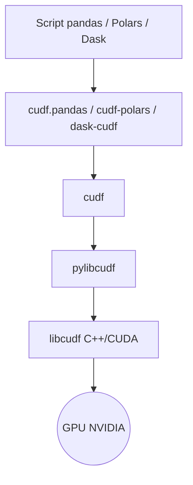

# rapidsai/cudf

> GPU DataFrame library for NVIDIA, pandas-compatible, for tabular data processing.

## The problem
pandas operations on large volumes are slow on CPU.

## What it actually does
libcudf (C++/CUDA) runs the algorithms on GPU. On top of it: pylibcudf (Cython bindings), cudf (pandas-like API), `cudf.pandas` (acceleration without changing code), cudf-polars (GPU engine for Polars) and dask-cudf. Used by cuML, cuGraph, XGBoost, Spark.

## How it is wired


## Trying it
```bash
pip install cudf-cu13
python -m cudf.pandas script.py
```

## Cost and gotchas
An NVIDIA GPU and a driver compatible with CUDA 12 or 13 are required; the package must match the CUDA version (suffix `-cu##`). No software cost.

## What it is not
Not a version of pandas that works everywhere: without a compatible GPU, nothing. The Polars GPU engine is announced as open beta.

## Alternatives
- Polars (cited): lazy CPU/GPU engine if you want to change API.
- Dask via dask-cudf: to spread work across several GPUs.

## For you
Adopt if you have an NVIDIA GPU: `python -m cudf.pandas` speeds up existing pandas code without rewriting.
