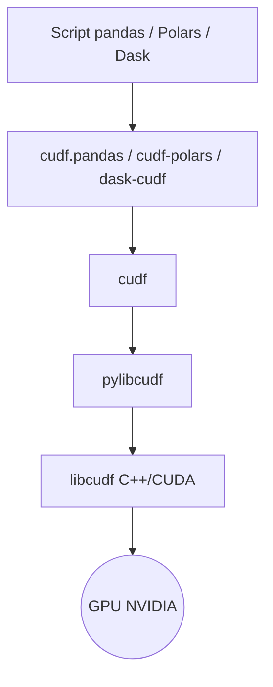

# rapidsai/cudf

> Bibliothèque de DataFrames sur GPU NVIDIA, compatible pandas, pour le traitement de données tabulaires.

## Le problème
Les opérations pandas sur gros volumes sont lentes sur CPU.

## Ce que ça fait vraiment
libcudf (C++/CUDA) exécute les algorithmes sur GPU. Au-dessus : pylibcudf (liaisons Cython), cudf (API proche de pandas), `cudf.pandas` (accélération sans changer le code), cudf-polars (moteur GPU pour Polars) et dask-cudf. Utilisé par cuML, cuGraph, XGBoost, Spark.

## Comment c'est branché


## Essayer
```bash
pip install cudf-cu13
python -m cudf.pandas script.py
```

## Coût et pièges
GPU NVIDIA et pilote compatible CUDA 12 ou 13 requis ; le paquet doit correspondre à la version de CUDA (suffixe `-cu##`). Pas de coût logiciel.

## Ce que ce n'est pas
Pas une version de pandas qui marche partout : sans GPU compatible, rien. Le moteur Polars GPU est annoncé en bêta ouverte.

## Alternatives
- Polars (cité) : moteur CPU/GPU lazy si tu veux changer d'API.
- Dask via dask-cudf : pour répartir sur plusieurs GPU.

## Pour toi
À adopter si tu as un GPU NVIDIA : `python -m cudf.pandas` accélère du pandas existant sans réécriture.

