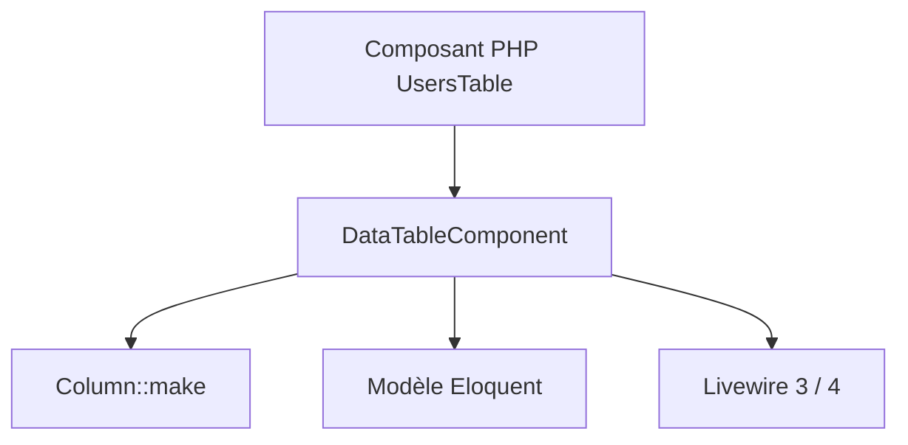

# rappasoft/laravel-livewire-tables

> Livewire component for displaying dynamic data tables in a Laravel application.

## The problem
Building sortable, filterable and paginated tables in Laravel takes a lot of repetitive code.

## What it actually does
A DataTableComponent class where you declare the model and the (sortable) columns. Works with Livewire 3 and 4, with Bootstrap 4, Bootstrap 5 and Tailwind demos. The minimal README points to the online documentation.

## How it is wired


## Trying it
```bash
composer require rappasoft/laravel-livewire-tables
composer test
```

## Cost and gotchas
Free. Requires PHP, Laravel and Livewire. Livewire ships with Alpine.js: do not load a second copy.

## What it is not
Not a BI or data science tool: it is a Laravel UI component.

## Alternatives
No alternative named in the README.

## For you
Ignore: PHP/Laravel component, outside your data/AI stack.
