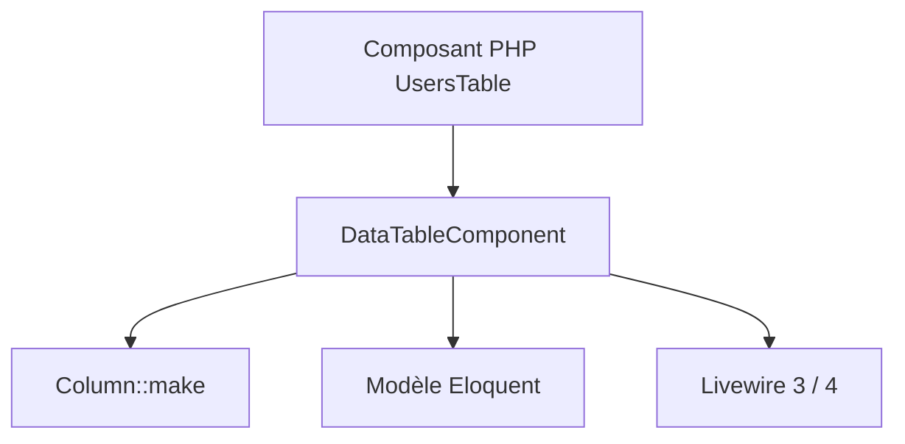

# rappasoft/laravel-livewire-tables

> Composant Livewire pour afficher des tables de données dynamiques dans une application Laravel.

## Le problème
Construire des tableaux triables, filtrables et paginés dans Laravel demande beaucoup de code répétitif.

## Ce que ça fait vraiment
Classe DataTableComponent où l'on déclare le modèle et les colonnes (triables). Fonctionne avec Livewire 3 et 4, démos Bootstrap 4, Bootstrap 5 et Tailwind. Le README minimal renvoie à la documentation en ligne.

## Comment c'est branché


## Essayer
```bash
composer require rappasoft/laravel-livewire-tables
composer test
```

## Coût et pièges
Gratuit. Requiert PHP, Laravel et Livewire. Livewire embarque Alpine.js : ne pas en charger une seconde copie.

## Ce que ce n'est pas
Pas un outil de BI ou de data science : c'est un composant d'interface Laravel.

## Alternatives
Aucune alternative nommée dans le README.

## Pour toi
Ignorer : composant PHP/Laravel, hors de ta stack data/IA.

